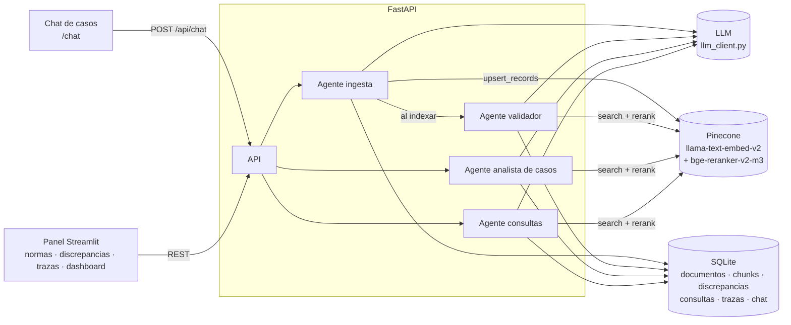

# Normativa Bancaria · Agentes de IA

Proyecto para el hackathon **"Hack AI Agents Impact"** (NTT DATA x Sundai LATAM, Perú Tech Week).
**Caso B2 – Banca: normativa y políticas internas.**

Demo: **https://169.58.187.13/chat** (chat de casos) · **https://169.58.187.13** (panel de administración)

## Problema

En un banco conviven reglamentos de la SBS, políticas internas, manuales y circulares, con varias versiones
de cada uno. Encontrar la norma correcta y **vigente** para una operación concreta es lento, y dos personas
pueden llegar a conclusiones distintas: una cita la versión reemplazada, otra no ve que el manual de agencias
contradice la política de crédito. El resultado son aprobaciones fuera de política, reprocesos y riesgo
regulatorio.

## Solución

Un equipo de agentes de IA que trabaja sobre el corpus normativo del banco:

1. **Agente de ingesta** — recibe una norma (PDF, DOCX o TXT), extrae sus metadatos (entidad, fechas de
   emisión y vigencia, versión, a qué norma reemplaza), la divide por artículo y la indexa en Pinecone.
   Marca de forma determinista las versiones reemplazadas.
2. **Agente validador** — compara los artículos nuevos con cifras, plazos o montos contra los más parecidos
   de otras normas y registra **contradicciones** y **actualizaciones**, con la cita literal de ambos lados.
   Un humano confirma o descarta cada discrepancia.
3. **Agente analista de casos** — el empleado describe o sube un caso real (una solicitud de crédito, una
   operación). El agente extrae los hechos, busca todas las reglas vigentes aplicables, las evalúa una por una
   con cálculos explícitos, revisa conflictos y versiones anteriores, señala los **vacíos normativos** y emite
   un **dictamen**: procede, procede con observaciones, no procede o requiere escalamiento.
4. **Agente de consultas** — responde preguntas cortas citando documento, artículo, versión y estado, y dice
   explícitamente cuando no encuentra una norma que lo respalde.

**No inventa:** cada cita se verifica en código contra el texto del fragmento recuperado. Si la cita no es
literal, se descarta. Si no hay respaldo, la respuesta es "No encontré una norma vigente que respalde esta
respuesta" y la pregunta queda registrada como tema sin cobertura en el dashboard.

**Trazabilidad:** cada ejecución guarda entrada, pasos de razonamiento, herramientas usadas, fragmentos
recuperados con su ID y score, modelo, latencia, usuario y salida. Se ve desde el chat ("Ver razonamiento del
agente") y desde el panel.

## Arquitectura



Despliegue: `Internet → Caddy (:80) → /api, /chat → FastAPI · resto → Streamlit`, con Docker Compose en un VPS.

- **Vector store:** Pinecone serverless, un índice con embeddings integrados (`llama-text-embed-v2`,
  1024 dimensiones, coseno) y reranking multilingüe (`bge-reranker-v2-m3`). Namespaces por entorno
  (`demo`, `dev`). Metadatos por fragmento: `doc_id, nombre_norma, entidad, tipo, tema, articulo, pagina,
  fecha_emision, fecha_vigencia, estado, version, reemplaza_a`. Sin clave, un índice local de respaldo.
- **Base relacional:** SQLite. Es la fuente de verdad del estado de cada norma; Pinecone sirve para recuperar.
- **LLM:** un solo módulo (`app/llm_client.py`). `LLM_PROVIDER=deepseek` (por defecto) o `anthropic`.

### Estructura

```
app/
  main.py               FastAPI: /, /chat, /health, /api/*
  llm_client.py         Único acceso al LLM (reintentos, timeouts, JSON tolerante)
  agents/               Framework de agentes: loop con tool calling, flujos, handoff, guardrails, traza
  normas/
    db.py               Esquema SQLite y helpers
    vector.py           Pinecone (embeddings + rerank) o índice local de respaldo
    parsing.py          Texto desde PDF / DOCX / TXT, detección de texto basura
    chunking.py         División por artículo
    ingesta.py          Pipeline de ingesta y vigencia
    validacion.py       Agente validador de discrepancias
    consultas.py        Agente de consultas con verificación de citas y confianza
    casos.py            Agente analista de casos y dictamen
    api_*.py            Endpoints (contrato en docs/CONTRATOS.md)
  static/chat.html      Interfaz del chat de casos
ui/streamlit_app.py     Panel de administración
corpus/                 Normas de demo (sintéticas y de ejemplo estilo SBS) y casos de ejemplo
scripts/seed_corpus.py  Carga del corpus de demo
```

## Cómo correrlo

```bash
cp .env.example .env     # DEEPSEEK_API_KEY (o ANTHROPIC_API_KEY + LLM_PROVIDER=anthropic), PINECONE_API_KEY
python -m venv .venv && .venv/Scripts/activate      # Linux/Mac: source .venv/bin/activate
pip install -r requirements.txt
python scripts/seed_corpus.py --reset               # carga SINT-01, SINT-02, SBS-EJ-01, SBS-EJ-02
uvicorn app.main:app                                 # http://127.0.0.1:8000/chat
streamlit run ui/streamlit_app.py                    # http://127.0.0.1:8501 (panel)
```

**Docker / VPS:** `docker compose up --build -d` y luego
`docker compose exec app python scripts/seed_corpus.py --reset`. Redesplegar:
`git push vps main && ssh root@<IP> 'cd ~/hacktaton && ./deploy.sh'`.

## Corpus y casos de demo

| Documento | Contenido clave |
|---|---|
| SINT-01 Política de Crédito de Consumo v1 | Reemplazada. Endeudamiento 40 %, scoring 600. |
| SINT-02 Política de Crédito de Consumo v2 | Vigente desde 2025-03-01. Endeudamiento 35 %, scoring 620, gerente de agencia hasta S/ 50,000. |
| SINT-03 Manual de Procedimientos de Agencias | Gerente de agencia hasta S/ 80,000: contradice SINT-02 Art. 8. Se sube en vivo. |
| SBS-EJ-01, SBS-EJ-02 | Documentos de ejemplo de estilo SBS (transparencia y reclamos, riesgo operacional). No son normas reales. |
| CASO-01 | Crédito de S/ 70,000 con endeudamiento de 50.8 % y scoring 610: no procede. |
| CASO-02 | Crédito que cumple todas las reglas: procede. |
| CASO-03 | Cliente no domiciliado con garantía en criptoactivos: vacío normativo, requiere escalamiento. |

## API principal

| Método | Ruta | Descripción |
|---|---|---|
| POST | `/api/chat` | Caso o consulta (multipart: `session_id`, `mensaje`, `archivo?`) → dictamen |
| POST | `/api/documentos` | Sube una norma → ingesta + validación |
| GET | `/api/discrepancias` | Contradicciones y actualizaciones detectadas |
| POST | `/api/consultas` | Consulta corta con citas |
| GET | `/api/trazas/{run_id}` | Traza completa de una ejecución |
| GET | `/api/dashboard` | Normas más consultadas, temas sin cobertura, discrepancias, uso |

Contratos completos en [docs/CONTRATOS.md](docs/CONTRATOS.md).

## Extensión: NANDA

El trabajo entre agentes viaja por `AgentTransport` (`app/agents/transport.py`). Conectar agentes externos vía
NANDA es implementar `deliver()` y pasar `Engine(transport=...)`, sin tocar agentes ni herramientas. No está
implementado.

## Código

Repositorio: **https://github.com/vega012/hacktaton**
